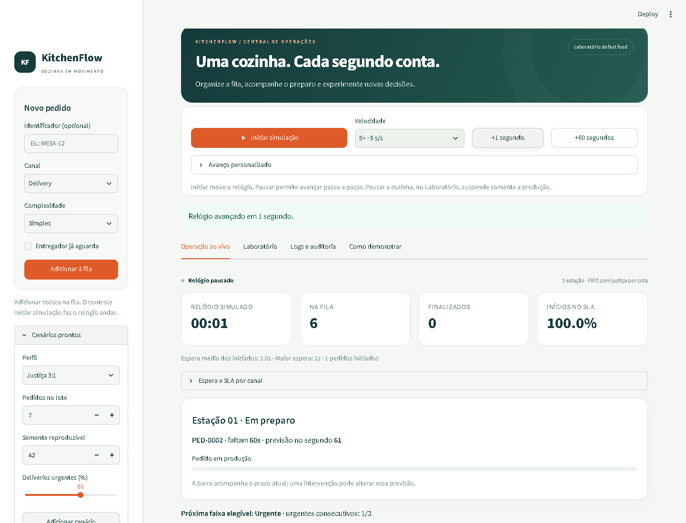

# KitchenFlow · laboratório de uma cozinha de fast food

Simulador acadêmico do Projeto A3, desenvolvido por sete integrantes com autorização do professor. O núcleo das sete etapas está integrado à interface Streamlit: prioridade, FIFO, cota contra starvation, SLA, intervenções manuais e histórico SQLite.



## Executar

Python **3.11 ou superior**. A versão da interface validada é Streamlit 1.67.0.

```powershell
python -m venv .venv
.\.venv\Scripts\python.exe -m pip install -r requirements.txt
.\.venv\Scripts\python.exe -m streamlit run app.py
```

No macOS/Linux, substitua `.venv\Scripts\python.exe` por `.venv/bin/python`.
Com uv: `uv sync --extra dev` e `uv run streamlit run app.py`. O arquivo `uv.lock` fixa a resolução das dependências.

## O que experimentar

Aplicativo publicado: [KitchenFlow no Streamlit](https://projetoa3sergio-fastfood.streamlit.app).

**Adicionar pedidos não inicia o relógio.** Use **Iniciar simulação**, no topo, para reproduzir; **Pausar simulação** permite usar +1, +60 ou avanço personalizado. A velocidade indica segundos simulados por segundo real ativo. Pausar a cozinha no Laboratório suspende só a produção.

O temporizador atualiza apenas a operação quando a reprodução está ligada. Formulários e navegação permanecem estáveis, e frações de tempo são acumuladas mesmo entre cliques frequentes. Após longa suspensão da aba, cada atualização recupera no máximo cinco segundos reais. O histórico é consultado sob demanda para evitar exportações pesadas a cada segundo.

Em **Logs e auditoria**, use a trilha global para conferir eventos, regras, incidentes, início/pausa da reprodução e avanços manuais. Filtre por operação ou busque ID/detalhe; exporte os filtrados em JSON ou o banco completo em SQL. **Atualizar histórico** busca os registros mais recentes. A auditoria pertence à sessão e não identifica pessoas; não há autenticação.

- Registrar pedidos individuais ou lotes de até 200 pedidos com semente reproduzível.
- Acompanhar duas faixas FIFO, pedido em preparo, próximo nível elegível, espera, metas, percentuais e indicadores por canal.
- Avançar manualmente ou reproduzir automaticamente, com chegadas intercaladas no tempo simulado.
- Alterar metas de SLA, durações simples/média/complexa, cota, limiar de risco e urgência de novos deliveries.
- Pausar a cozinha sem parar o relógio, redefinir o tempo restante de um preparo e cancelar pedidos aguardando.
- Baixar SQL completo, incluindo estrutura, eventos, intervenções, timestamps e ordem global.

## Regras e efeitos das mudanças

O padrão representa **uma estação não preemptiva**. Delivery com entregador aguardando entra como urgente; os demais são padrão. A prioridade permanece no ticket. Cada faixa respeita FIFO. Depois de até três inícios urgentes, o padrão mais antigo recebe sua oportunidade, se estiver esperando. Uma fila vazia não bloqueia a outra.

SLA mede **entrada na fila até início do preparo**. Metas iniciais: delivery 180 s, retirada 300 s, balcão 480 s. Preparo: simples 60 s, médio 120 s, complexo 180 s. Alerta em 80% da meta; excesso somente quando espera > meta. Espera exatamente igual à meta cumpre o SLA se o preparo iniciar. Todos esses valores são hipóteses didáticas, não dados de restaurantes reais.

- **SLA e prioridade:** alterações valem para novos pedidos. Tickets existentes preservam a configuração de admissão e seus resultados históricos.
- **Duração por complexidade:** vale no próximo início de preparo. O preparo atual mantém sua previsão até uma intervenção explícita.
- **Cota:** muda imediatamente, preservando o contador acumulado limitado à nova cota.
- **Limiar de alerta:** muda a sinalização atual de tickets aguardando; não reescreve eventos.
- **Pausa da reprodução:** congela o relógio. **Pausa da cozinha:** ao avançar o relógio, o preparo fica suspenso e a espera continua crescendo.
- **Ajustar preparo atual:** define o novo tempo restante (não soma esse valor); registra antes/depois no histórico.

A cota limita os urgentes entre oportunidades da faixa padrão. Não limita a espera de todo ticket a três pedidos, porque podem existir padrões mais antigos à frente. Sob sobrecarga, SLAs podem ser violados. A simulação torna esses gargalos observáveis. Não há garantia contra uma cozinha pausada indefinidamente ou parâmetros alterados continuamente de forma adversarial.

`advance(0)` consulta sem alterar estado; o primeiro despacho ocorre no próximo segundo. IDs são únicos por sessão, inclusive após conclusão ou cancelamento. Chegadas devem coincidir com o relógio atual. A capacidade didática é de até 2000 pedidos simultâneos aguardando; avanço máximo de 86400 s por comando.

## Persistência e integridade

Cada sessão tem um banco exclusivo em `data/` (ignorado pelo Git). Reruns preservam o motor em `st.session_state`. Reiniciar a sessão mantém o banco anterior em disco e cria outro. Atualizar/reabrir o navegador pode criar nova sessão: o projeto preserva os logs, mas **não retoma automaticamente o motor a partir do banco**. Exporte o SQL antes de encerrar a demonstração.

No Streamlit Community Cloud, o disco local é temporário e pode ser perdido em reinícios/redeploys. O download SQL é a cópia portátil para guardar a auditoria.

`queue_events` guarda eventos operacionais; `simulation_actions` guarda regras e intervenções; `audit_sequence` ordena ambos inclusive no mesmo segundo. Transações e checkpoints restauram memória e SQL juntos em caso de falha. Triggers rejeitam UPDATE/DELETE usuais, e IDs de eventos não podem ser duplicados. Isso não constitui proteção criptográfica contra um administrador que altere o arquivo/schema.

O download é autossuficiente e deve ser importado em **banco vazio**:

```python
import sqlite3
from pathlib import Path
with sqlite3.connect('reproducao.sqlite3') as connection:
    connection.executescript(Path('logs.sql').read_text(encoding='utf-8'))
    print(connection.execute('SELECT * FROM audit_sequence ORDER BY sequence').fetchall())
```

`sql/schema.sql` também é disponibilizado separadamente. Reimportar no mesmo banco é rejeitado por duplicidade. Reconstruir o histórico não equivale a retomar uma sessão executável.

## Testes e demonstrações reproduzíveis

```powershell
.\.venv\Scripts\python.exe -m unittest discover -s tests -v
.\.venv\Scripts\ruff.exe check .
.\.venv\Scripts\python.exe scripts\simulate.py
```

A suíte cobre domínio, FIFO, justiça, limites de SLA, entradas inválidas, rollback de falhas, exportação/importação, sessões isoladas, intervenções, cenários aleatórios e widgets via AppTest. Veja [evidências e limitações](docs/validacao.md).

Regressão opcional em navegador: instale `playwright` e seu Chromium (`python -m playwright install chromium`), depois execute `python scripts/check_browser.py --url http://localhost:8502` com o app nessa porta. Também aceita a URL publicada e usa Edge headless quando disponível no Windows. Verifica relógio, foco do formulário, pausa, incidentes, SQL e sessão mobile isolada; evidências ficam em `tmp/`.

`scripts/simulate.py` gera `exports/cenarios.json` e um SQL de exemplo. Os resultados representam 40 chegadas simultâneas, semente 42, com capacidade deliberadamente sobrecarregada; não representam desempenho de um restaurante real.

## Apresentação e arquitetura

- [Apresentação final](entregas/final/kitchenflow_apresentacao.pptx)
- [Relatório técnico final](entregas/final/relatorio_tecnico.md) e [versão Word para entrega](entregas/final/relatorio_tecnico.docx)
- [Diagrama detalhado e contratos](entregas/final/diagrama_completo.md)
- [Diagrama visual para abrir no navegador](entregas/final/diagrama_completo.html)
- [Roteiro de demonstração e arguição](entregas/final/roteiro.md)
- [Escopo atualizado](docs/escopo.md), [modelagem](docs/modelagem.md), [dicionário](docs/dicionario.md)
- [Planejamento original em sete etapas](docs/planejamento.md)
- Materiais de 10/11 em `entregas/primeira_entrega/` são registros históricos, anteriores à conclusão.

## Organização e autoria

`app.py` e `assets/` apresentam os dados; `domain/` define tipos e regras; `queues/` mantém FIFO e política; `services/` coordena decisões e cenários; `audit/` persiste eventos. A interface não substitui a regra do domínio.

Os arquivos enviados para a Etapa 7 foram integrados e revisados. O teste enviado de chegada em t=50 foi corrigido para avançar o motor até esse instante antes da inserção. O acesso privado à conexão SQLite na interface foi substituído por uma API pública de auditoria. Os commits anteriores dos integrantes permanecem no histórico, sem reescrita de autoria. Cada membro deve explicar suas decisões, contratos e testes.

Este é um protótipo acadêmico com apresentação de produto. Não inclui pagamentos, clientes reais, integrações comerciais, múltiplas estações, autenticação ou implantação pública. Esses recursos exigiriam outra fase de produto.
