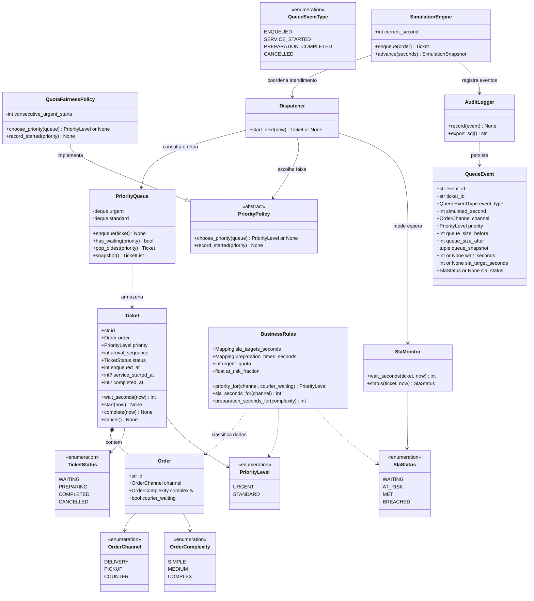

# Modelagem orientada a objetos

**Etapa 1:** contrato e modelo inicial. As classes futuras aparecem no diagrama para orientar as sete etapas; somente `OrderChannel`, `OrderComplexity`, `TicketStatus`, `PriorityLevel`, `SlaStatus`, `QueueEventType`, `QueueEvent` e `BusinessRules` são implementadas nesta etapa.

## Diagrama inicial de classes

## Responsabilidades e limites

- **Domínio:** `Order`, `Ticket` e enums representam dados e estados válidos. `Ticket` mantém um `Order` por composição e registra a prioridade definida na entrada.
- **Regras:** `BusinessRules` fornece prioridades, metas de SLA, duração de preparo, cota e limiar de risco. Ela não enfileira nem despacha tickets.
- **Estrutura:** `PriorityQueue` mantém FIFO separada por nível. Ela não decide qual nível deve vencer.
- **Política:** `PriorityPolicy` define o contrato; `QuotaFairnessPolicy` aplica a cota sem retirar tickets da estrutura.
- **Serviços:** `SlaMonitor` calcula espera e estado do SLA; `Dispatcher` escolhe e inicia o próximo ticket; `SimulationEngine` controla tempo e preparo.
- **Auditoria:** serviços emitem `QueueEvent`. `AuditLogger` recebe eventos e, em outra etapa, os grava e exporta SQL.
- **Interface:** Streamlit chama o motor e apresenta dados; não acessa ou altera diretamente as filas internas.

## Contratos compartilhados

| Classe | Método ou atributo | Contrato |
|---|---|---|
| `BusinessRules` | `priority_for(channel, courier_waiting)` | Recebe canal como texto ou enum e `courier_waiting` como `bool`; retorna `URGENT` apenas para delivery com entregador aguardando. |
| `BusinessRules` | `sla_seconds_for(channel)` | Recebe canal como texto ou enum e retorna a meta configurada em segundos. |
| `BusinessRules` | `preparation_seconds_for(complexity)` | Recebe complexidade como texto ou enum e retorna a duração configurada. |
| `BusinessRules` | `urgent_quota` | Retorna a quantidade máxima configurada de inícios urgentes consecutivos quando há padrão esperando. |
| `PriorityQueue` | `enqueue(ticket)` | Coloca no final da faixa correspondente, preservando FIFO. |
| `PriorityQueue` | `has_waiting(priority)` | Informa se há ticket aguardando na faixa. |
| `PriorityQueue` | `pop_oldest(priority)` | Remove e retorna o primeiro ticket da faixa; faixa vazia gera erro de fila vazia. |
| `PriorityQueue` | `snapshot()` | Devolve um retrato em ordem de atendimento, sem alterar filas. |
| `PriorityPolicy` | `choose_priority(queue)` | Retorna a faixa escolhida ou `None` se ambas estiverem vazias; não retira o ticket. |
| `PriorityPolicy` | `record_started(priority)` | Atualiza a política somente quando o despacho realmente inicia. |
| `SlaMonitor` | `wait_seconds(ticket, now)` | Calcula `now - enqueued_at`, sem incluir o tempo de preparo. |
| `SlaMonitor` | `status(ticket, now)` | Classifica espera, risco, cumprimento ou excesso conforme o estado e o limite. |
| `Dispatcher` | `start_next(now)` | Escolhe e inicia um ticket, ou retorna `None` se não houver fila. |
| `SimulationEngine` | `enqueue(order)` | Cria ticket no segundo simulado atual e emite evento de entrada. |
| `SimulationEngine` | `advance(seconds)` | Avança o relógio e conclui preparo quando seu tempo termina. |
| `AuditLogger` | `record(event)` | Recebe um evento de fila tipado, sem depender de Streamlit. |
| `AuditLogger` | `export_sql()` | Retorna SQL executável para reconstruir eventos gravados. |

## Complexidade prevista para as filas

Com uma `collections.deque` por prioridade, inserir e remover no início/final custam **O(1)**. Consultar a disponibilidade de uma faixa custa **O(1)**. Criar um `snapshot()` completo visita os tickets e custa **O(n)**. A política consulta somente as duas faixas, então escolher a próxima faixa custa **O(1)**.
