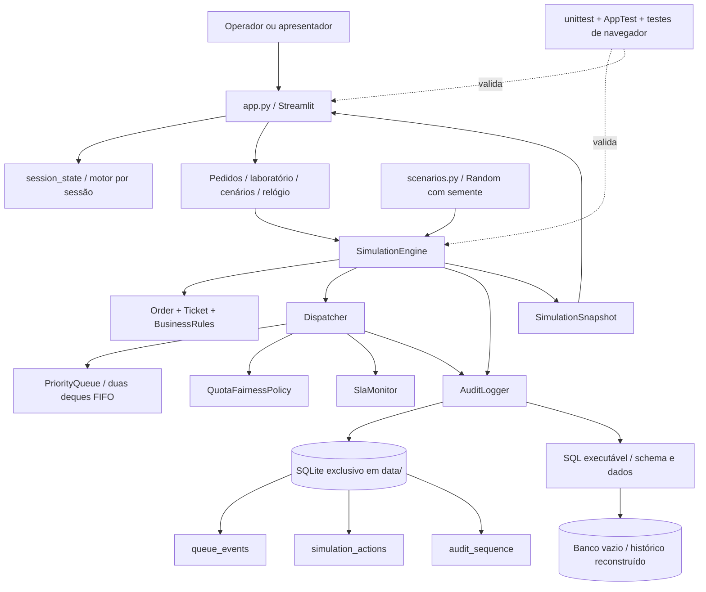
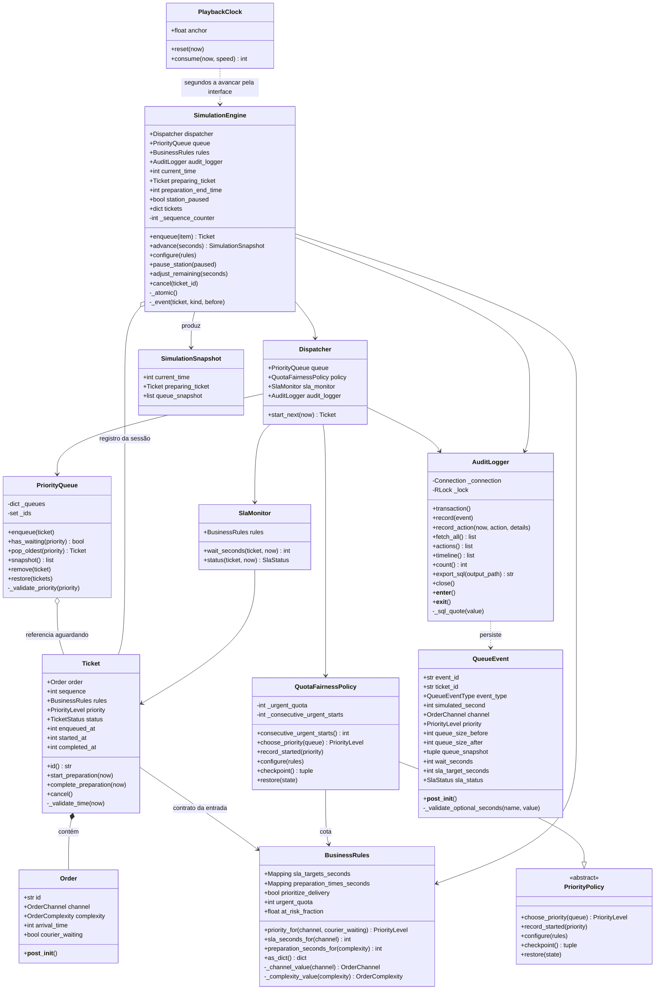
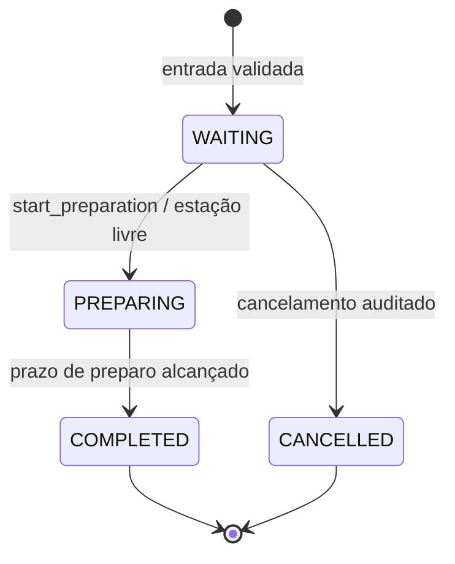
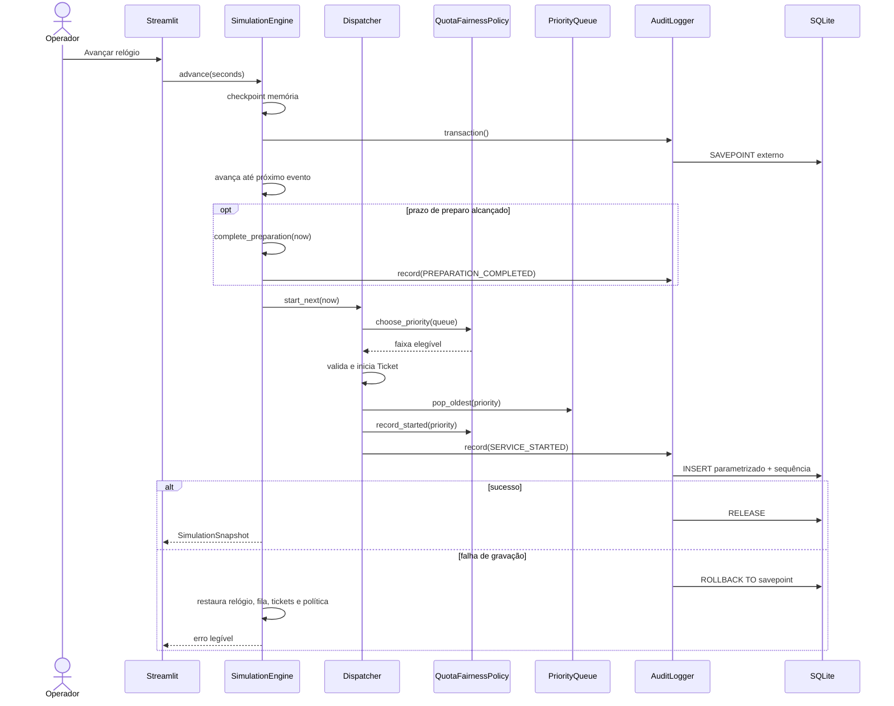
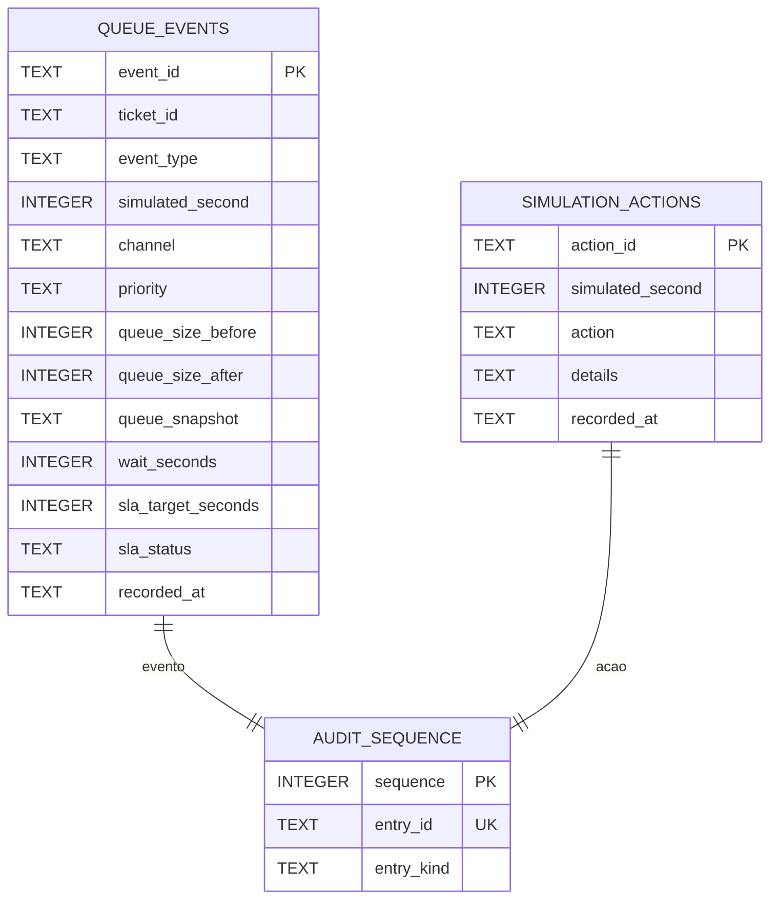

# KitchenFlow — diagrama completo do projeto

Versão final de 15/11/2026. `+` indica API pública; `-` indica detalhe interno por convenção Python. A implementação é a referência para assinaturas. Diagramas separados tornam os relacionamentos legíveis; o catálogo abaixo complementa atributos e métodos.

## 1. Arquitetura e fronteiras

## 2. Classes, composição, herança e dependências

`Order`, `BusinessRules` e `QueueEvent` são dataclasses congeladas. `Ticket` é mutável por transições. `SimulationSnapshot` congela a estrutura externa, mas contém referências aos tickets; não é uma cópia histórica profunda. O snapshot persistido no evento guarda apenas IDs imutáveis. Horários de início/conclusão, ticket em preparo e dados de SLA podem ser `None` antes de existirem.

## 3. Estados operacionais e SLA

O estado operacional é independente de `SlaStatus`. Aguardando: WAITING → AT_RISK ao consumir o limiar; BREACHED se espera > meta. Ao iniciar: MET se espera <= meta, BREACHED caso contrário. Alterar limiar pode modificar o alerta de aguardando; a espera dos iniciados fica congelada. Cancelados não entram nos indicadores de inícios.

Enums: `OrderChannel` = DELIVERY/PICKUP/COUNTER; `OrderComplexity` = SIMPLE/MEDIUM/COMPLEX; `PriorityLevel` = URGENT/STANDARD; `TicketStatus` = WAITING/PREPARING/COMPLETED/CANCELLED; `QueueEventType` = ENQUEUED/SERVICE_STARTED/PREPARATION_COMPLETED/CANCELLED; `SlaStatus` = WAITING/AT_RISK/MET/BREACHED.

## 4. Uma decisão de atendimento e a recuperação de falhas

## 5. Modelo relacional e ordem global

As relações com `audit_sequence` são lógicas, mantidas por triggers, não FKs: cada linha aponta para **um evento ou uma ação**, conforme `entry_kind`. `queue_snapshot` e `details` armazenam JSON. `recorded_at` é o horário real do registro; `simulated_second` é o relógio didático. Exportação percorre a sequência, inclui timestamps originais e recria a ordem ao inserir em banco vazio. Triggers bloqueiam UPDATE/DELETE; não protegem contra administrador que remova o schema.

Ações: CONFIG_INITIAL, CONFIG_CHANGED, BURST, STATION_PAUSE, STATION_RESUME e PREPARATION_ADJUSTED. Eventos: entrada, início, conclusão e cancelamento. Uma alteração de configuração não reescreve o histórico nem o contrato dos tickets antigos.

## 6. Contratos de interface, algoritmos e fronteiras

`create_engine()` injeta dependências; `add_burst()` usa Random local e transação de lote; `metrics()` agrega somente eventos de início. `app.py` usa formulários para aplicar mudanças explicitamente, `st.session_state` para manter a sessão e `st.fragment(run_every=1)` para a atualização visual. A reprodução simula segundos em passos definidos; chegadas são intercaladas segundo a segundo. O motor em si salta até eventos para evitar loops em intervalos vazios.

A fila usa duas `deque`: inserir/remover o primeiro e consultar faixa custam O(1), inclusive detecção de ID repetido pelo conjunto `_ids`. Cancelar ticket arbitrário é O(n). Snapshot, checkpoint e métricas são O(n) no número de tickets ou eventos lidos. O despacho completo inclui snapshot/auditoria e não deve ser anunciado como inteiramente O(1).

O limite de 2000 aguardando e lotes de até 200 protege a demonstração contra cliques excessivos. Não representa dimensionamento comercial. Histórico, registro de todos os tickets e eventos acumulam por sessão. A camada de UI não tem transação própria: chama o motor e mostra falhas esperadas. A auditoria usa RLock porque reruns podem usar threads distintas, enquanto cada motor pertence a uma única sessão.

## 7. Rastreabilidade das sete etapas

1. Regras, enums, contratos e base: `domain/rules.py`, `enums.py`, `events.py`.
2. Pedido e ticket: `domain/order.py`, `ticket.py`.
3. Filas: `queues/priority_queue.py`.
4. Política: `queues/priority_policy.py` (abstração e herança).
5. Serviços: `services/sla_monitor.py`, `dispatcher.py`, `simulation_engine.py`.
6. Auditoria: `audit/audit_logger.py`, `sql/schema.sql`.
7. Experiência e integração: `app.py`, `assets/style.css`, `services/scenarios.py`, testes ponta a ponta e documentos finais.

As melhorias finais ampliam os contratos das etapas anteriores sem reescrever o histórico de contribuições. Ver [README](../../README.md) para instalação, efeitos de cada controle e limites de persistência.
