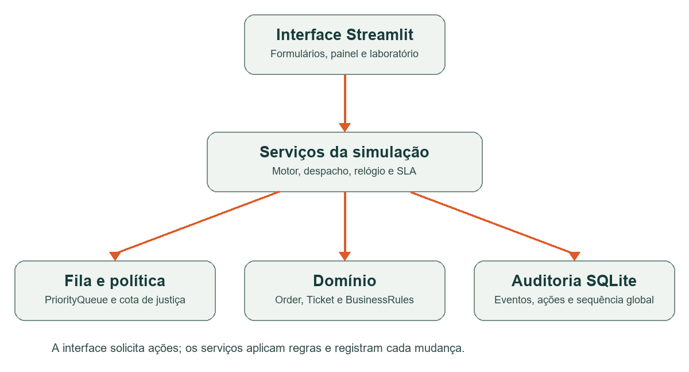
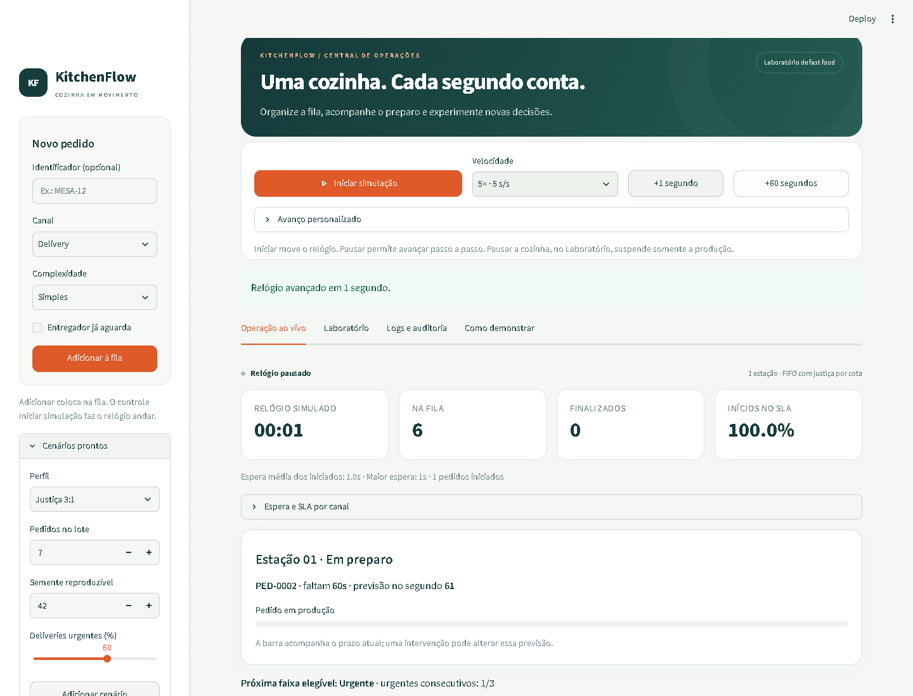

# Relatório técnico final do projeto KitchenFlow

**Projeto A3 — Filas de prioridade em uma cozinha de fast food** 
**Área:** Python, orientação a objetos, simulação, Streamlit e auditoria SQLite 
**Equipe:** sete integrantes, distribuídos em sete etapas de desenvolvimento 
**Versão do relatório:** 17 de novembro de 2026 
**Repositório:** https://github.com/JeffRosaDev/projeto_a3_sergio 
**Aplicativo:** https://projetoa3sergio-fastfood.streamlit.app

## Resumo executivo

O KitchenFlow é um protótipo acadêmico que simula uma cozinha com uma estação de preparo, pedidos de balcão, retirada e delivery, duas faixas de prioridade e um relógio em segundos. O sistema permite observar como a urgência do delivery afeta pedidos comuns, medir a espera até o início do preparo e testar uma política de justiça que reserva oportunidades para a faixa padrão. Uma interface Streamlit apresenta o estado operacional e um banco SQLite registra decisões e intervenções na ordem em que ocorreram.

O projeto implementa as sete etapas planejadas: regras e contratos, pedido e ticket, fila, política de prioridade, serviços e SLA, auditoria SQL e interface integrada. Os parâmetros numéricos são hipóteses didáticas configuráveis. Na verificação local mais recente, 73 testes passaram e o Ruff não apontou infrações nas regras configuradas. Os três cenários reproduzíveis mostram que a cota preserva oportunidades de atendimento, mas não aumenta a capacidade física da cozinha nem garante o SLA sob uma chegada simultânea de 40 pedidos.

Este relatório descreve o que foi planejado, o que foi implementado, como o código se organiza, o que foi observado na validação e quais são os limites do protótipo. Os trechos de código abaixo foram selecionados dos módulos do projeto e são explicados no contexto de cada decisão.

## 1 Problema objetivo e recorte

Uma cozinha recebe pedidos por canais diferentes e precisa escolher qual preparar primeiro quando há mais trabalho do que capacidade imediata. No cenário escolhido pelo grupo, um entregador de delivery que já está aguardando torna esse pedido operacionalmente urgente. Se todo urgente passar sempre à frente, novos deliveries podem adiar por tempo indefinido os pedidos comuns. Esse adiamento é o problema de starvation que o projeto busca mitigar.

O objetivo é demonstrar uma decisão de atendimento explicável: manter FIFO dentro de cada faixa, dar preferência aos urgentes até uma cota e então oferecer a próxima oportunidade ao padrão mais antigo. O sistema também registra a espera, compara essa espera com uma meta de SLA e permite alterar hipóteses para observar consequências.

O recorte é uma simulação, com uma estação não preemptiva. Quando o preparo começa, um pedido novo não o interrompe. Não há clientes reais, pagamento, estoque, entrega física, autenticação ou integração com sistemas comerciais. A escolha de fast food e a equipe de sete integrantes foram autorizadas pelo professor conforme informado pelo grupo. As metas e durações descritas adiante não são dados reais do setor.

## 2 Planejamento e execução das sete etapas

O planejamento estabeleceu dependências entre as etapas: cada módulo deveria oferecer contratos estáveis para o próximo integrante, com revisão, testes e integração antes de prosseguir. A distribuição foi por responsabilidade técnica, sem atribuição de nomes neste relatório.

| Etapa | Responsabilidade planejada | Entrega implementada |
| --- | --- | --- |
| 1 | Definir cenário, regras, enums e contratos públicos | BusinessRules, enums, QueueEvent e documentação de escopo |
| 2 | Criar pedido, ticket e transições de estado | Order e Ticket com validações e ciclo de vida |
| 3 | Construir a estrutura FIFO por prioridade | PriorityQueue com duas deques, snapshot e restauração |
| 4 | Aplicar justiça contra starvation | PriorityPolicy e QuotaFairnessPolicy com contador de urgentes |
| 5 | Coordenar despacho, relógio e SLA | Dispatcher, SimulationEngine e SlaMonitor |
| 6 | Persistir fatos e exportar histórico executável | AuditLogger, schema SQLite, sequência global, SQL e JSON |
| 7 | Integrar interface, demonstração e documentação | Streamlit, cenários, histórico filtrável, README e validação |

A etapa seguinte consumiu as interfaces definidas pela anterior: o motor recebe a política e a fila por composição; o despachante pede uma faixa à política e retira o ticket mais antigo dessa faixa; o logger recebe eventos tipados, sem depender da interface. A integração final acrescentou regras dinâmicas, rollback conjunto de memória e SQL, reprodução automática e uma trilha de auditoria legível.

O protocolo de trabalho previa branches individuais, commits próprios, revisão da etapa anterior e preservação do histórico Git. A apresentação foi planejada para 24/11/2026, com pitch, demonstração e arguição individual. O planejamento detalhado e os critérios de aceite permanecem em docs/planejamento.md.

## 3 Requisitos e hipóteses da simulação

O edital de filas de prioridade pede orientação a objetos, mitigação de starvation, acompanhamento de SLA, registros SQL íntegros, UML, dicionário de classes, documentação e demonstração. Para a stack Python adotada pelo grupo, a interface é Streamlit. O projeto separa esses requisitos das escolhas didáticas feitas para permitir uma demonstração reproduzível.

| Parâmetro inicial | Valor | Significado |
| --- | --- | --- |
| Estações de preparo | 1 | Capacidade compartilhada e não preemptiva |
| Cota de urgentes | 3 | Máximo de inícios urgentes consecutivos quando há padrão esperando |
| SLA delivery | 180 s | Espera da entrada até o início do preparo |
| SLA retirada | 300 s | Mesma medida para pedidos de retirada |
| SLA balcão | 480 s | Mesma medida para pedidos de balcão |
| Preparo simples / médio / complexo | 60 / 120 / 180 s | Duração determinística por complexidade |
| Limiar de risco | 80% da meta | Sinalização antes do excesso de SLA |

Um delivery só entra como urgente quando o entregador já aguarda e a regra correspondente está habilitada. Os demais entram na faixa padrão. A prioridade e a meta de SLA ficam preservadas no ticket no momento de sua admissão. Alterar esses parâmetros posteriormente afeta novas chegadas; durações novas valem para próximos inícios. A cota e o limiar de alerta têm efeito imediato. Um preparo já iniciado mantém sua previsão até que haja ajuste explícito do tempo restante.

## 4 Modelo de domínio e arquitetura orientada a objetos

Order representa os dados de entrada do pedido. Ticket contém Order, guarda sequência, prioridade, regras de admissão, horários e estado operacional. O ciclo permitido é WAITING, PREPARING e COMPLETED, com CANCELLED apenas a partir da espera. QueueEvent é um fato imutável que descreve a alteração na fila, com tamanho anterior e posterior e snapshot dos IDs que continuam aguardando.

BusinessRules centraliza os parâmetros configuráveis. PriorityPolicy é um contrato abstrato; QuotaFairnessPolicy o concretiza. PriorityQueue guarda os tickets em duas faixas FIFO. SlaMonitor calcula a espera e classifica o SLA. Dispatcher toma uma decisão de início, enquanto SimulationEngine coordena estação, relógio e mudanças atômicas. AuditLogger encapsula SQLite. A interface app.py chama esses serviços e apresenta o resultado, sem duplicar a política de prioridade.

O fluxo principal é: formulário ou cenário cria Order; SimulationEngine cria Ticket e o coloca na fila; Dispatcher consulta QuotaFairnessPolicy, retira o mais antigo da faixa escolhida e inicia o preparo; SlaMonitor mede a espera; AuditLogger registra o evento; Streamlit mostra o estado atualizado. A composição e as dependências completas estão no diagrama de classes do projeto.

**Figura 1.** Arquitetura em camadas: interface, serviços, fila, domínio e auditoria. Os demais diagramas em entregas/final detalham classes, estados, transações e modelo relacional.

## 5 Estrutura de dados e política contra starvation

A fila usa uma deque para URGENT e outra para STANDARD. A inserção no fim e a retirada do início de cada faixa têm custo O(1). Um conjunto de IDs rejeita duplicidade entre pedidos que ainda aguardam. O snapshot reúne as duas faixas para leitura e auditoria, sem remover tickets, e custa O(n). Por isso o despacho completo, que também cria checkpoints e registra eventos, não é descrito como O(1).

A política consulta as faixas sem consumi-las. O contador só muda quando um preparo realmente começa. Se há padrões aguardando e a cota de três urgentes foi atingida, o próximo início é padrão. Se a faixa padrão está vazia, os urgentes continuam sendo atendidos e o contador permanece limitado à cota. Quando um padrão inicia, o contador volta a zero.

**Trecho real de src/fastfood/queues/priority_policy.py:**

    def choose_priority(self, queue: PriorityQueue) -> PriorityLevel | None:
        has_urgent = queue.has_waiting(PriorityLevel.URGENT)
        if has_urgent and self._consecutive_urgent_starts < self._urgent_quota:
            return PriorityLevel.URGENT
        if queue.has_waiting(PriorityLevel.STANDARD):
            return PriorityLevel.STANDARD
        if has_urgent:
            return PriorityLevel.URGENT
        return None

Esse método escolhe uma faixa, não um pedido específico. A fila fornece o mais antigo da faixa. A sequência urgente, urgente, urgente, padrão é um exemplo de oportunidade garantida quando ambas as faixas têm pedidos. Um ticket padrão pode esperar mais de três preparos se houver outros padrões antigos à frente. A cota mitiga starvation em operação contínua com durações finitas; não promete um limite fixo de espera nem o cumprimento de todo SLA.

## 6 Relógio simulado despacho e medição de SLA

SimulationEngine usa segundos inteiros e uma estação. Um pedido entra no segundo atual; o primeiro despacho acontece ao avançar o relógio. Quando um preparo termina, o próximo pode começar no mesmo segundo. Em intervalos sem mudanças relevantes, o motor salta até o próximo evento. O PlaybackClock acumula frações do tempo real entre atualizações da página e limita a recuperação após uma aba ficar suspensa. A reprodução automática intercala chegadas nas fronteiras do tempo simulado.

O SLA mede apenas a espera até o início do preparo: espera = segundo de início menos segundo de entrada. A duração do preparo não entra nesse cálculo. Antes do início, o ticket fica em risco ao alcançar 80% da meta e excede a meta se a espera for maior que ela. Depois do início, a espera é congelada: menor ou igual à meta significa MET; acima dela significa BREACHED.

**Trecho real de src/fastfood/services/sla_monitor.py:**

    def status(self, ticket, now: int) -> SlaStatus:
        wait = self.wait_seconds(ticket, now)
        limit = ticket.rules.sla_seconds_for(ticket.order.channel)
        if ticket.started_at is not None:
            return SlaStatus.MET if wait <= limit else SlaStatus.BREACHED
        if wait > limit:
            return SlaStatus.BREACHED
        if wait >= limit * self.rules.at_risk_fraction:
            return SlaStatus.AT_RISK
        return SlaStatus.WAITING

Pausar a reprodução congela o avanço do relógio. Pausar a cozinha suspende o trabalho físico enquanto o relógio continua e a espera aumenta. Ajustar o restante substitui a previsão atual do preparo. Cancelar só é permitido enquanto o pedido aguarda. Configurações, pausas, ajustes, cancelamentos e avanços manuais aparecem na trilha de auditoria.

## 7 Integridade transacional e auditoria

Cada sessão Streamlit tem um banco SQLite exclusivo em data, fora do controle de versão. A tabela queue_events guarda entradas, inícios, conclusões e cancelamentos. simulation_actions registra configuração inicial, alterações, lotes, pausas, ajustes e comandos de reprodução. audit_sequence numera ambos os tipos na ordem global de gravação, inclusive quando compartilham o mesmo segundo simulado.

AuditLogger usa transações com savepoints e um RLock para serializar o acesso à conexão da sessão. O motor cria checkpoints do relógio, tickets, fila, regras e política. Se a gravação falha, a operação devolve memória e banco ao estado anterior. Triggers rejeitam UPDATE e DELETE usuais nas três tabelas. IDs de eventos únicos rejeitam duplicidade. Essa proteção mantém consistência operacional, mas não impede um administrador de remover triggers ou alterar o arquivo.

**Consulta adaptada de src/fastfood/audit/audit_logger.py:**

    def timeline(self) -> list[dict]:
        with self._lock:
            rows = self._connection.execute("""
                SELECT s.sequence, s.entry_kind, s.entry_id,
                       COALESCE(e.event_type,a.action) AS operation,
                       e.ticket_id, e.queue_size_before, e.queue_size_after,
                       e.queue_snapshot, e.wait_seconds, e.sla_target_seconds,
                       e.sla_status, a.details
                FROM audit_sequence s
                LEFT JOIN queue_events e
                  ON s.entry_kind='event' AND s.entry_id=e.event_id
                LEFT JOIN simulation_actions a
                  ON s.entry_kind='action' AND s.entry_id=a.action_id
                ORDER BY s.sequence
            """).fetchall()
            return [dict(row) for row in rows]

O trecho acima foi reduzido aos campos centrais para caber no relatório; a consulta do arquivo também inclui segundo simulado, horário UTC, canal e prioridade. O SQL exportado contém schema e dados, com nomes de colunas e valores em linhas separadas e comentários que identificam cada registro. Ele pode ser executado em um banco vazio para reconstruir a trilha, sem restaurar automaticamente o motor em memória. O JSON exportado agrupa cada evento por pedido, fila e SLA, ou cada ação por parâmetros, com legenda e filtros aplicados.

O histórico identifica a operação, o ID do registro, o pedido quando houver, o segundo simulado e o horário UTC de gravação. Não há autenticação nem identificação pessoal do operador. O aplicativo oferece uma lista resumida e um painel de detalhes por registro na aba Logs e auditoria.

## 8 Interface Streamlit e experiência de uso

A interface possui quatro áreas: Operação ao vivo, Laboratório, Logs e auditoria e Como demonstrar. A barra lateral recebe pedidos individuais e lotes reproduzíveis. O painel operacional mostra relógio, quantidade aguardando, finalizados, proporção de inícios no SLA, estação ativa, faixas e sinais de risco. A reprodução pode ser iniciada ou pausada; os avanços manuais ficam disponíveis quando pausada.

No Laboratório, o usuário altera metas de SLA, tempos de preparo, cota, limiar de alerta e regra de urgência para novas admissões. Também pode pausar a estação, ajustar um preparo ativo ou cancelar um pedido aguardando. Na auditoria, filtros por tipo, operação e texto reduzem a trilha. A tabela mostra uma linha curta por registro; a seleção de um registro revela pedido, canal, prioridade, fila anterior e posterior, ordem dos IDs aguardando, espera, meta e resultado de SLA. Ações mostram seus parâmetros em JSON. O SQL completo e o JSON filtrado podem ser baixados.

**Figura 2.** Captura da operação ao vivo com controles de pedido, relógio, indicadores e estação. A interface atual mantém as abas e acrescenta a apresentação detalhada da auditoria.

O estado da sessão permanece em st.session_state durante as atualizações do Streamlit. O histórico é consultado sob demanda, evitando exportações pesadas a cada segundo. Reiniciar exige confirmação e cria uma nova sessão. Erros esperados são exibidos em texto; falhas durante a reprodução interrompem a execução e preservam o motivo para leitura.

## 9 Validação técnica e experimentos

A suíte local mais recente executou 73 testes com sucesso, abrangendo domínio, regras, fila, justiça, SLA, simulação, rollback, auditoria, reimportação SQL, sessões isoladas, concorrência e widgets via Streamlit AppTest. O Ruff não encontrou infrações nas regras E4, E7, E9 e F. O workflow do GitHub executa testes e lint em Python 3.11, 3.12 e 3.13 a cada push e pull request. O roteiro de navegador também verificou a versão publicada, incluindo reprodução, foco de formulário, pausas, incidentes, SQL reimportado, JSON filtrado e sessão mobile isolada.

O teste de estresse verifica que um padrão aguardando recebe oportunidade mesmo diante de uma sequência longa de urgentes. Os testes de falha forçada confirmam rollback de banco e memória. Os limites exatos do SLA incluem início igual à meta, que ainda cumpre. O SQL de exportação foi reimportado com preservação de campos, horários e ordem global.

O script scripts/simulate.py aplica os mesmos 40 pedidos simultâneos, semente 42, a três condições. Todos os pedidos foram iniciados e concluídos nos três cenários. A conformidade representa a proporção de inícios dentro da meta de espera, não de entregas concluídas no prazo.

| Cenário | Iniciados | Concluídos | Inícios no SLA | Espera média | Maior espera |
| --- | --- | --- | --- | --- | --- |
| Padrão | 40 | 40 | 10,0% | 2.123,5 s | 4.681 s |
| Preparo lento | 40 | 40 | 7,5% | 4.246,0 s | 9.361 s |
| Pausa inicial de 300 s | 40 | 40 | 0,0% | 2.423,5 s | 4.981 s |

O lote de 40 chegadas simultâneas sobrecarrega deliberadamente uma estação. Dobrar durações quase dobra a espera média; uma pausa inicial de 300 s eleva a espera e elimina os inícios dentro do SLA nesse cenário. A política mantém oportunidades justas, mas não cria capacidade. Os números são resultados da simulação, não previsão de desempenho de um restaurante real. Os dados completos estão em exports/cenarios.json.

## 10 Limites e evolução possível

O protótipo não retoma automaticamente o motor depois que uma sessão Streamlit se perde; o SQL recupera fatos registrados, não a execução em andamento. No Streamlit Community Cloud, o disco local pode ser temporário em reinícios e novas implantações. O download SQL serve como cópia portátil da auditoria. Bancos de sessões longas acumulam eventos e snapshots, consumindo memória e armazenamento.

A reprodução depende da aba aberta e não é um cronômetro de precisão comercial. Snapshots e checkpoints têm custo proporcional ao tamanho da fila. A estação única, tempos determinísticos e pedidos fictícios simplificam a operação real. Não há autenticação, controle de acesso por pessoa, múltiplas estações ou prova criptográfica de integridade dos logs. Uma evolução de produto exigiria persistência central, restauração de estado, observabilidade, dados reais anonimizados, calibração de capacidade e validação em dispositivos adicionais.

## 11 Como executar e reproduzir

É necessário Python 3.11 ou superior. A versão da interface declarada pelo projeto é Streamlit 1.67.0. Na raiz do repositório, os comandos em Windows são:

    python -m venv .venv
    .\.venv\Scripts\python.exe -m pip install -r requirements.txt
    .\.venv\Scripts\python.exe -m streamlit run app.py

Para reproduzir a validação e os cenários:

    .\.venv\Scripts\python.exe -m unittest discover -s tests -v
    .\.venv\Scripts\ruff.exe check .
    .\.venv\Scripts\python.exe scripts\simulate.py

O script escreve exports/cenarios.json, exports/logs.sql e exports/auditoria.json. O SQL completo deve ser importado em banco vazio. Consulte o README para macOS, Linux, uv e o roteiro de navegador; docs/validacao.md registra os resultados e limites dos testes.

## 12 Materiais e rastreabilidade

Os materiais complementares permitem verificar cada etapa e reproduzir a demonstração:

| Arquivo ou pasta | Conteúdo principal |
| --- | --- |
| README.md | Instalação, execução, regras atuais e comandos de validação |
| docs/planejamento.md | Plano original, divisão das sete etapas e critérios de aceite |
| docs/escopo.md e docs/dicionario.md | Contratos vigentes, classes, métodos e estruturas |
| entregas/final/diagrama_completo.md | UML, estados, sequência transacional e modelo SQL |
| entregas/final/kitchenflow_apresentacao.pptx e roteiro.md | Slides e sequência da apresentação |
| docs/validacao.md e tests/ | Evidências, limites e testes automatizados |
| exports/ | Cenários reproduzíveis e exemplos da auditoria SQL e JSON |

O edital fornecido pelo professor, A3 Projeto Semestral Filas de Prioridade, orientou os requisitos e a apresentação. O código, os testes, os artefatos de exportação e o histórico público do repositório permitem confrontar as afirmações deste relatório com a implementação. A equipe deve conseguir explicar individualmente as decisões de sua etapa e a integração do sistema.
